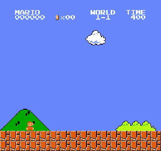
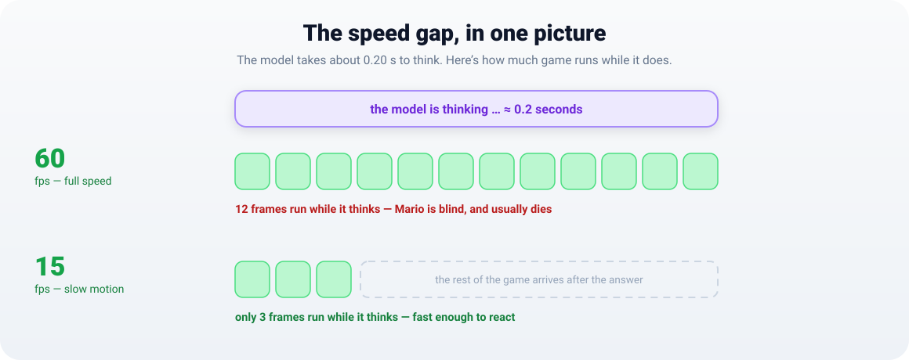
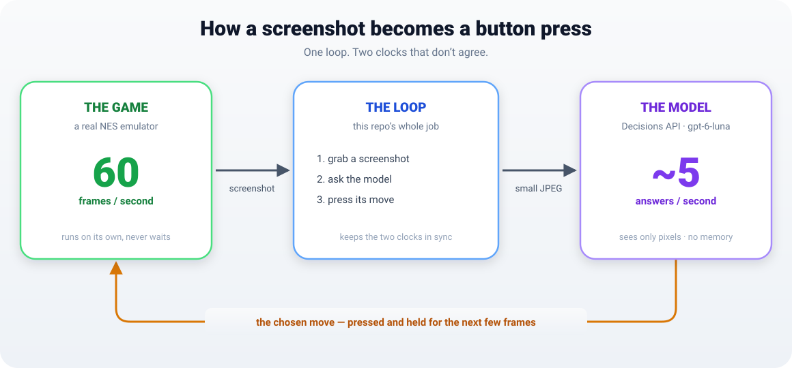

<div align="center">

# 🍄 mario-decisions-agent

### An AI that plays Super Mario Bros by *looking* at the screen — one screenshot at a time.

No memory hacks. No hidden game state. Pixels in, button out.




<sub>An AI model playing World 1-1 from raw screenshots — slowed down so you can watch.</sub>

<sub>The real model is the OpenAI Decisions API (<code>gpt-6-luna</code>); reproducing these runs needs your own API key.</sub>

</div>

---

## What is this?

Most bots that play games cheat a little. They read the game's memory to find out exactly
where Mario is, how fast he's moving, and what's coming next — then choose a button.
**This one can't do any of that.** It sees what you'd see in a screenshot: one frozen
picture of the level. Its entire brain is a remote vision model on the other end of the
OpenAI **Decisions API**, and the only thing it is ever asked is:

> *"Here's a picture of the screen. Which move gets me further?"*

That limitation is the whole point, because it turns the project into a clean, honest
test of a genuinely open question:

> **How well can a modern vision model play a real-time game when it can only look at
> still pictures and reply a few times per second?**

The short answer: surprisingly well. The *interesting* answer is where it breaks — and
why. Super Mario Bros updates its world **60 times every second**. The model can only
answer about **5 times per second**. Closing that gap is what this repo is about.

## The problem: two clocks that don't agree

Imagine playing Mario, but with a twist: after every move you have to phone a very smart
friend, describe the screen, and wait for them to tell you what to do next. You can only
react as fast as they answer.

- The **game** never waits. It advances 60 steps every second.
- The **model** takes about **0.2 seconds** to reply — so at best it gets to decide about
  **5 times a second**.

While the model is thinking, Mario keeps running. Get the timing wrong and he walks
straight into a Goomba. Managing that timing — *without* secretly feeding the model extra
information — is the entire project.

<p align="center">
  
</p>

## How well does it actually do?

Measured, not guessed. The model's steady reply time is **~0.20 s**, and everything here
comes down to one clash: the game advances **60 frames a second**, the model answers about
**5 times a second**.

We ran the same match at three game speeds — **15, 30 and 60 fps** — holding everything
else fixed (each move covers **8 game frames**), twice each:

| Game speed | Reply time | Game frames each move really covers | Decisions | Distance | Watch |
|--:|--:|--:|--:|--:|--:|
| 15 fps | 0.19 s | **8** | 36 | **722** | [▶](docs/media/live_fps15.mp4) |
| 30 fps | 0.16 s | **8** | 36 | **722** | [▶](docs/media/live_fps30.mp4) |
| 60 fps | 0.20 s | **12** | 40 | **722** | [▶](docs/media/live_fps60.mp4) |

Here's what we found:

- **At 15 and 30 fps, slowing the game down changes only the clock — not the game.** The
  model answers faster than each move lasts, so it plays the *exact same* game both times:
  same decisions, same frames, just stretched over 19.8 s instead of 10.0 s. Slow motion is
  a viewing trick, not a difficulty setting.
- **At 60 fps, the model can't keep up.** Its answer arrives about **12 frames** after the
  question, so every move ends up covering about 12 frames instead of the 8 we asked for.
  The game keeps moving while the model is still thinking — that's the speed gap, and it
  shows up as stalling.
- **On World 1-1, it doesn't cost a life either way.** All three runs get to the same spot,
  because 1-1 is the most-copied level in gaming and a model that already knows it can hide
  bad timing. So this is a claim about **timing**, not about score.

It all comes down to one line:

```
game frames each move really covers  =  max( frames_per_decision ,  latency × game_fps )
```

As long as the model answers before a move ends, the next answer is already waiting when the
move finishes. Once `latency × game_fps` gets bigger than `frames_per_decision`, the model
starts falling behind.

## Watch the three runs

| 15 fps | 30 fps | 60 fps |
|---|---|---|
|  |  |  |

The 15 and 30 fps clips are the *same game* at two speeds — the model makes the same moves
on the same frames, just played slower. The 60 fps clip is where it starts lagging behind
the action.

## Try it in 60 seconds

The emulator, the game loop, and an offline stand-in "brain" all run locally — **no API
key, no network, no ROM download**:

```bash
git clone https://github.com/parjanyaacoder/mario-decisions-agent
cd mario-decisions-agent
uv venv --python 3.12
source .venv/bin/activate                 # Windows: .venv\Scripts\activate
uv pip install -e ".[mario,record]"

python -m mda --env mario --backend mock --render --scale 3 --fps 30 --frames-per-decision 8
```

A window opens and a simple offline heuristic plays the game using the *exact same loop*
the real model uses.

> **Every number and clip in this README comes from the real model, and reproducing them
> needs your own OpenAI API key.** The offline `--backend mock` path runs the whole thing
> for free, but only `--backend live` with `OPENAI_API_KEY` set talks to the actual
> Decisions API (`gpt-6-luna`). See [Using the real model](#using-the-real-model).

---

## How it works

Three pieces, cleanly separated — and each one swappable, which is why the whole thing
can run offline:

- **The world** — a real NES emulator stepping the game 60 times a second.
- **The brain** — a remote model that sees one small JPEG and returns one move.
- **The loop** — the glue that keeps a 60 Hz world and a ~5 Hz brain in sync.

<p align="center">
  
</p>

**One decision, end to end:**

1. The emulator advances **one frame** and hands back an RGB picture.
2. The loop shrinks it to a small JPEG and asks the model two things: *which move next?*
   and *is a hazard coming up?*
3. The model answers with one of **10 sensible moves** — run right, short hop, high jump,
   wait, back up, and so on — instead of raw button mashing.
4. The loop presses that move and lets it play out for a few frames — while the *next*
   question is already on its way to the model.

### Project layout

```
mario-decisions-agent/
├── src/mda/
│   ├── __main__.py     command-line interface
│   ├── loop.py         blocking + pipelined game loops, frame pacing
│   ├── env.py          MockEnv (offline toy platformer) + MarioEnv (real NES, lazy import)
│   ├── backends.py     MockBackend (offline heuristic) + LiveBackend (/v1/decisions)
│   ├── actions.py      10-move macro menu (held + tapped buttons, per-frame masks)
│   ├── cache.py        trick E: perceptual-hash frame cache
│   ├── viewer.py       resizeable, pixel-crisp game window
│   ├── video.py        headless MP4 / GIF / PNG recording
│   ├── hud.py          on-screen HUD (fps, latency, chosen move, cost)
│   └── recorder.py     JSONL run log
├── scripts/
│   ├── probe_latency.py       measure the model's real reply time — run this first
│   ├── make_preview_gifs.py   turn recorded runs into the clips in docs/media
│   └── make_readme_pdf.py     render this README to a PDF (needs Chrome)
├── tests/
│   └── test_pipeline.py       17 offline tests: no key, no ROM, no network
├── docs/
│   ├── architecture.svg       how the world, the loop and the brain fit together
│   ├── speed-gap.svg          why a ~5 Hz brain fights a 60 Hz game
│   ├── mario-decisions-agent.pdf   this README as a printable PDF
│   └── media/                 the committed clips this README plays
└── pyproject.toml             dependencies + the `mario` / `record` / `docs` extras
```

Curious how it runs with no key? `MockEnv` is a tiny hand-built platformer — gravity,
variable jumps, pits, pipes, Goombas, scrolling — that exercises the whole loop offline.
`MockBackend` is a crude pixel heuristic that plays the real game well enough to rehearse
the timing.

## Five tricks for closing the gap

The game makes 60 frames a second; the model can only answer a few times a second. These
five tricks close the difference, and each one is a command-line flag:

| | Trick | Flag | What it buys |
|---|---|---|---|
| **A** | **Bigger steps** | `--frames-per-decision N` | one answer covers N frames |
| **B** | **Ask ahead** | `--mode pipelined` | the next question is already on its way while the game keeps moving |
| **C** | **Smaller picture** | `--max-side` / `--jpeg-quality` | a smaller image means faster, cheaper answers (**never cropped**) |
| **D** | **Slow the game down** | `--fps N` / `--auto-fps` | real slow motion, so a quick reply becomes fine control |
| **E** | **Skip identical frames** | `--cache` | if the screen barely changed, repeat the last move |

**D can work itself out.** Tell it how much lag you'll accept (`--auto-fps --stale-budget
10`) and it picks the game speed for you: a 0.25 s reply → ~40 fps, a 1 s reply → ~10 fps.
Slower game, snappier agent — but a longer watch.

**C never crops.** It makes the picture smaller and lower quality, but never cuts anything
out. Cut out the edges and you hide the Goomba — and a model that can't see the Goomba picks
the wrong move. `--save-frames DIR` saves exactly what was sent, so you can check.

**E saves time and money, not skill.** It compares frames with a rough 16×16 fingerprint, so
if the screen barely changed it can repeat the last move. `--cache-max-reuse` forces a fresh
call anyway, so a frozen screen can't lock the agent in place. It's switched off for the
blank-frame control, where every frame is identical and the cache would fake a perfect score.

## Honest limits

Don't quote any number above without reading this.

- **World 1-1 is probably memorized.** It's the most-copied level in gaming, and the model
  has seen it many times. A good score here is **not** proof that it can see — knowing the
  level can hide bad timing.
- **Only two runs per speed, on one level.** The 15 and 30 fps pairs matching exactly is the
  clean part; the rest is still a small sample on a single, famous level.
- **A slow reply breaks the pattern.** One 30 fps run got a 0.49 s reply instead of 0.16 s,
  stalled ~9 frames per move, and stopped short at x=434. Reply times vary, and the loop is
  only as good as its worst reply.
- **Slow motion isn't real time.** At 15 fps the game runs 4× slower than you'd see it.
  Keeping up at 15–30 fps is real; at a true 60 fps the model falls behind.

## Using the real model

You'll need a standard OpenAI key — the Decisions API is public beta, no waitlist. Measure
first, then play:

```bash
export OPENAI_API_KEY=sk-...

python scripts/probe_latency.py --repeats 5   # measure the model's real reply time
python -m mda --env mario --backend live --auto-fps --cache \
    --scale 3 --record runs/live.mp4          # watch it play (and save the video)
```

Prefer it fully offline? Both commands work with `--backend mock` and no key at all.

### Key flags

| Flag | Meaning |
| --- | --- |
| `--env mock\|mario` | toy platformer vs. real game |
| `--backend mock\|live` | offline stand-in vs. the real model |
| `--mode blocking\|pipelined` | freeze during thinking vs. overlap it |
| `--frames-per-decision N` | how many frames each move is held |
| `--fps N` | how fast the game runs in real time (`0` = as fast as possible) |
| `--auto-fps` / `--stale-budget` | pick the game speed from measured latency |
| `--control normal\|blank` | run the blank-frame control |
| `--max-side` / `--jpeg-quality` | image budget — the main speed/cost lever |
| `--world` / `--rom-mode` | which level, and which sprite set (`vanilla`/`pixel`/`rectangle`/`downsample`) |
| `--render` / `--scale N` | show the game window, at N× size |
| `--record PATH` / `--record-fps` | save the run as `out.mp4`/`.gif` or a folder of PNGs |
| `--cache` / `--cache-threshold` / `--cache-max-reuse` | the reuse-unchanged-frames trick |
| `--save-frames DIR` | dump every image actually sent to the model |
| `--out PATH` | write a per-decision JSONL log |
| `--mock-latency` / `--mock-sleep` | simulate latency to rehearse timing offline |

## Reproduce these results

```bash
export OPENAI_API_KEY=sk-...                        # a live run needs your own key
python scripts/probe_latency.py --repeats 5         # expect ~0.20 s

# same sweep as the table above: step size fixed, only the game speed changes
for fps in 15 30 60; do
  python -m mda --env mario --backend live --mode pipelined \
      --fps $fps --frames-per-decision 8 --max-decisions 40 \
      --scale 3 --record runs/live_fps$fps.mp4 --no-hud
done
```

Reply times wobble, so run each speed a few times. Run the offline test suite any time with
`python tests/test_pipeline.py` (17 tests, no key or network).

## Cost

The Decisions API bills **input only** — $0.10 per million tokens, nothing for output. A
single decision is about **500 input tokens ≈ $0.00005**, a twentieth of a cent. The whole
six-run sweep above cost about **a cent**. Cost is never the bottleneck here — latency is.

## License

MIT — see [LICENSE](LICENSE).

<div align="center"><sub>Not affiliated with Nintendo or OpenAI. Super Mario Bros is a trademark of Nintendo; the game ROM is bundled by <code>gym-super-mario-bros</code> for research use.</sub></div>
