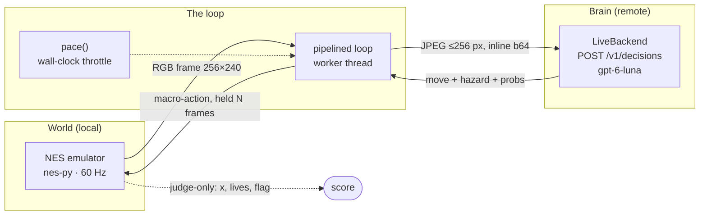

<div align="center">

# 🍄 mario-decisions-agent

**A screenshot-only Super Mario Bros agent whose entire brain is the OpenAI Decisions API.**

`POST /v1/decisions` · model `gpt-6-luna` · no RAM peeking · pixels in, button out


<sub>Real run: `gpt-6-luna` playing World 1-1 from raw screenshots, slowed to 15 fps so you can watch. [Full video ↓](#-the-runs)</sub>

</div>

---

## The question

> **Can a vision-based Decisions-API agent make progress in a real-time physics
> game from screenshots alone?**

The interesting part isn't "can it beat 1-1". It's the **speed mismatch**: the NES
steps **60 times per second**, and the API answers roughly **5 times per second**.
Almost everything in this repo exists to manage that gap honestly.

## Headline result

Measured, not vibes: the API answers in **~0.20 s**, so the agent's decision rate is
capped near **5 per second** no matter what. Raising the game's real-time speed
visibly starves it.

| run | game fps | frames/decision | decisions before death | reached x | stalls / decision | cost | video |
|---|--:|--:|--:|--:|--:|--:|---|
| A | **15** | 8 | **40** (ran out of budget) | **722** | 2.4 | $0.00216 | [▶︎ `live_fps15.mp4`](docs/media/live_fps15.mp4) |
| B | **30** | 12 | **19** (died) | **694** | 5.0 | $0.00105 | [▶︎ `live_fps30.mp4`](docs/media/live_fps30.mp4) |
| C | **60** | 20 | **3** (died) | **315** | 9.7 | $0.00021 | [▶︎ `live_fps60.mp4`](docs/media/live_fps60.mp4) |

Two clean laws fall out of this, and they are the whole project in two lines:

```
decisions per second of GAME  =  60 / frames_per_decision      # how often we're allowed to think
game-frames that pass per call =  latency × wall_fps           # how stale the frame is when the answer lands
```

At 15 fps an answer arrives ~2.4 game-frames stale. At 60 fps, ~11 — Mario has
already run blind for a sixth of a second. (Honest caveat: runs A–C varied
`frames-per-decision` *and* fps together, so this sweep shows "faster game → worse"
but doesn't isolate fps alone. See [Threats to validity](#-threats-to-validity).)

## ▶ The runs

GitHub can't autoplay a repo video, so each recording ships as a GIF (below) **and**
the full-resolution MP4 (links above). All are **768×720**, upscaled 3× with
nearest-neighbour so the pixels stay crisp.

<div align="center">

| 15 fps — survived to the budget | 30 fps — died after 19 decisions | 60 fps — dead in 3 |
|---|---|---|
|  |  |  |

</div>

The 15 fps clip is genuine 4× slow motion (the game is throttled so the agent gets
time to think). The 60 fps clip is real-time — and Mario is dead in under two
seconds of game time.

---

## Architecture

The design separates the **world** (emulator), the **brain** (API), and the
**loop** that reconciles two clocks that don't agree. Both the environment and the
backend are pluggable interfaces, so the entire pipeline runs offline with no key.



**One step, end to end:**

1. `env.step_buttons(...)` advances the emulator **one** frame and returns an RGB
   `(240, 256, 3)` array.
2. The loop encodes it (JPEG, ≤256 px on the long side, inline base64) and sends it
   to `/v1/decisions` as a `choice` question (`next_move`) plus a `predicate`
   (`hazard_imminent`).
3. The model replies with a labelled move from a **10-action macro space**
   (`RUN_RIGHT`, `SHORT_HOP_RIGHT`, `HIGH_JUMP_RIGHT`, `WAIT_OR_DUCK`,
   `BACKTRACK_LEFT`, …). Each macro is held for `frames_per_decision` frames, with
   variable button press/release timing per frame.
4. The loop applies that action while — in pipelined mode — the **next** request is
   already in flight on a background thread.

### Project layout

```
src/mda/
  actions.py    reduced macro-action space (held + tapped buttons, per-frame masks)
  env.py        MockEnv (offline toy platformer) + MarioEnv (real NES, lazy import)
  backends.py   MockBackend (offline heuristic) + LiveBackend (/v1/decisions)
  cache.py      Layer E: perceptual-hash frame cache
  viewer.py     resizeable, pixel-crisp pyglet window (replaces nes-py's viewer)
  video.py      headless MP4 / GIF / PNG recording
  loop.py       blocking + pipelined game loops, frame pacing
  hud.py        terminal HUD (FPS, latency, pick, hazard, cost)
  recorder.py   JSONL run log
  __main__.py   CLI
scripts/
  probe_latency.py       one-frame latency probe — run this first
  make_preview_gifs.py   runs/*.mp4 -> docs/media/*.gif for this README
tests/test_pipeline.py   offline tests: no key, no ROM, no network
```

Everything is a swap-in interface. `MockEnv` is a tiny procedural platformer (with
gravity, variable jumps, pits, pipes, Goombas and scrolling) so the loop, macros,
pipelining, pacing and recording can all be exercised **with no key, no ROM and no
network**. `MockBackend` is a crude pixel heuristic that plays the real game well
enough to rehearse latency offline.

## The five speed-mismatch layers

The whole codebase is organised around five ways to bridge a 60 Hz game and a ~0.2 s
API. All five are implemented:

| | Layer | Flag | What it buys |
|---|---|---|---|
| **A** | **Macro-actions** | `--frames-per-decision N` | one answer covers N frames instead of one |
| **B** | **Pipelining** | `--mode pipelined` | a worker thread keeps a request in flight while the emulator keeps moving |
| **C** | **Shrink the request** | `--max-side` / `--jpeg-quality` | smaller image → lower latency and cost (**downscale, never crop**) |
| **D** | **Slow the wall clock** | `--fps N` / `--auto-fps` | true slow motion, so a fast reply maps to fine control |
| **E** | **Reuse when nothing changed** | `--cache` | replay the last move when the screen is ~identical |

**Layer D computes itself.** Given measured latency, `fps ≈ stale_budget / latency`
(`--auto-fps --stale-budget 10`): 0.25 s → ~40 fps, 1 s → ~10 fps. Lower fps is more
responsive but the playthrough takes longer in real time.

**Layer C never crops.** It downscales and JPEG-compresses, keeping the *full* field
of view. Cropping would hide obstacles, and a model that can't see a Goomba picks the
wrong move. Run with `--save-frames runs/frames` to eyeball exactly what was sent.

**Layer E is a latency/cost trick, not a capability one.** Frames are compared by a
16×16 perceptual hash (`--cache-threshold`, Hamming bits of 256), with
`--cache-max-reuse` forcing a fresh call so a frozen screen can't lock the agent into
one move. It is deliberately **disabled for the blank control**, where every frame is
identical and the cache would fake a perfect hit rate.

---

## Challenges (the stuff that actually bit)

This is the honest log of what broke and why. Every item below has code and/or a test.

**1. The measurement that reframed everything.** The first live call took **4.07 s** —
which looks fatal. The next five took **0.17–0.23 s**. That first number is a cold
start; the steady state is **~0.20 s**, which turns "impossible" into "genuinely
near-real-time at low fps". *Measure before designing.* (`scripts/probe_latency.py`)

**2. Transient `503`s.** Mid-probe, the endpoint returned `503 Service Unavailable`
and killed the run — one blip would have aborted a recording. Added exponential-backoff
retries for `408/409/425/429/5xx` and a test that drives two 503s then a success.

**3. A macOS crash that only appears on episode 2.** nes-py's viewer destroys its
pyglet window on `close()`, and macOS can't create a *second* GL window in the same
process:
```
AttributeError: ObjCInstance b'PygletDelegate' has no attribute b'initWithAttributes_'
```
Fixed by building the environment **once** and reusing it across episodes. Also
replaced nes-py's fixed 256×240 viewer with our own (`viewer.py`), which is
resizeable, pixel-crisp, and shuts down cleanly — clicking the close button used to
leave the loop blitting into a destroyed window.

**4. `--fps` was silently ignored in blocking mode.** Frame pacing lived only in the
pipelined branch, so rendered blocking runs flashed by at thousands of fps. Pacing is
now a shared helper used by both loops.

**5. Where does "unchanged" mean unchanged?** An exact-hash cache would essentially
never fire in a moving game. The usable version is a perceptual hash with a small
Hamming threshold — which catches the real case (a stationary screen) without
reusing a stale action when something subtle entered the frame.

**6. Dependency pins from real failures.** `numpy<2` (`nes-py` overflows a `uint8`
`prg_rom_size`) and `gym<0.26` (0.26 changed `step()` to a 5-tuple; `nes-py` still
returns 4). No ROM download needed — `gym-super-mario-bros` bundles the NES ROM plus
`pixel`/`rectangle`/`downsample` variants for visual-perturbation controls.

## Methodology & controls

The project is built to be *disbelieved*, not believed:

- **Blanked-frame control** (`--control blank`) — same pipeline, information-free
  frame. If performance barely drops, the model is recalling, not seeing.
- **Visual-perturbation ROMs** (`--rom-mode pixel|rectangle|downsample`) — sprites are
  replaced, so the model can't key on familiar pixel patterns.
- **Unseen / perturbed levels** (`--world …`) — layout memory can't help.
- **Judge-only RAM.** `env.score()` reads `x`, `lives`, `time`, `flag_get` from the
  emulator to *score* runs. It is **never** placed in the prompt. The agent only ever
  receives pixels.
- **Artifact logging.** `--save-frames` writes the exact JPEG sent; `--record` writes
  the played frames; `--out` writes per-decision JSONL.

## ⚠️ Threats to validity

Read this before quoting any number above.

- **World 1-1 is probably memorized.** It's the most-reproduced level in gaming and
  the model's knowledge cutoff is well after it. A good score here is **not** proof of
  vision — hence the controls above.
- **Single seed.** Runs A–C are one episode each. The "30/60 fps is worse" trend is
  suggestive, not statistically established.
- **fps is confounded with macro length.** The sweep raised `frames-per-decision`
  alongside fps. A clean experiment holds it constant (e.g. 8) across 15/30/60 and
  adds seeds; that's the next run.
- **Slow motion isn't real-time.** At 15 fps the game runs 4× slower than a human
  would see it. "Near-real-time" here means ~30–60 fps.

## Setup

Uses [`uv`](https://github.com/astral-sh/uv) with Python 3.12 (`nes-py` has no wheels
for 3.14):

```bash
git clone https://github.com/parjanyaacoder/mario-decisions-agent
cd mario-decisions-agent
uv venv --python 3.12
uv pip install -e ".[mario,record]"     # [mario] = emulator; [record] = MP4 writing
```

Then `export OPENAI_API_KEY=sk-...` for the live path. The Decisions API is public
beta — no waitlist or special access.

## Usage

**Offline (no key, no ROM, no network):**

```bash
python -m mda --env mock --backend mock --mode pipelined
python -m mda --env mario --backend mock --render --scale 3 --fps 30 --frames-per-decision 8
```

**Live (measured first, then played):**

```bash
python scripts/probe_latency.py --repeats 5        # measure real latency
python -m mda --env mario --backend live --auto-fps --cache \
    --scale 3 --record runs/live.mp4               # watch + record
```

**Run the tests:**

```bash
python tests/test_pipeline.py     # 16 offline tests, no key / ROM / network
```

### Key flags

| Flag | Meaning |
| --- | --- |
| `--env mock\|mario` | toy platformer vs. real NES emulator |
| `--backend mock\|live` | offline heuristic vs. `/v1/decisions` |
| `--mode blocking\|pipelined` | freeze during inference vs. overlap it |
| `--frames-per-decision N` | how long each macro-action is held (latency cover) |
| `--fps N` | wall-clock pacing (`0` = emulator as fast as possible) |
| `--auto-fps` / `--stale-budget` | derive fps from measured latency (`fps ≈ stale_budget / latency`) |
| `--control normal\|blank` | `blank` runs the blanked-frame control |
| `--max-side` / `--jpeg-quality` | image budget — the main latency/cost lever |
| `--world` / `--rom-mode` | level, and `vanilla\|pixel\|rectangle\|downsample` ROMs |
| `--render` / `--scale N` | NES window; `--scale 3` ⇒ 768×720, pixel-crisp |
| `--record PATH` / `--record-fps` | write `out.mp4`/`.gif` or a PNG directory |
| `--cache` / `--cache-threshold` / `--cache-max-reuse` | Layer E perceptual-hash cache |
| `--save-frames DIR` | dump every JPEG actually sent to the API |
| `--out PATH` | JSONL run log (per-decision + summary) |
| `--mock-latency` / `--mock-sleep` | simulated latency; rehearse the mismatch offline |

## Reproduce the results

```bash
export OPENAI_API_KEY=sk-...
python scripts/probe_latency.py --repeats 5         # ~0.20 s expected

for fps in 15 30 60; do
  case $fps in 15) fpd=8;; 30) fpd=12;; 60) fpd=20;; esac
  python -m mda --env mario --backend live --mode pipelined \
      --fps $fps --frames-per-decision $fpd --max-decisions 40 \
      --scale 3 --record runs/live_fps$fps.mp4 --no-hud
done

python scripts/make_preview_gifs.py                 # rebuild README previews
```

## Cost

`/v1/decisions` bills **input tokens only** — $0.10 / 1M, no output charge. A 256×240
JPEG is ~**1,050 tokens ≈ $0.0001 per decision**. The entire three-run sweep above cost
**under half a cent** (`$0.00216 + $0.00105 + $0.00021`). For scale: a full 1-1 attempt
is pennies, so cost is never the constraint — latency is.

## Roadmap

- **Controlled sweep**: fix `frames-per-decision` across 15/30/60 fps, 3+ seeds each,
  to isolate the fps effect from macro length.
- **Control arms in anger**: run `--control blank` and the `pixel`/`rectangle` ROMs on
  1-1 to separate vision from recall.
- **Unseen levels**: score on hacked/perturbed layouts where memory can't help.
- **Predictive pipelining**: request the next decision slightly *before* the macro
  ends, to hide latency instead of paying for it as stalls.

## License

MIT — see [LICENSE](LICENSE).

<div align="center"><sub>Not affiliated with Nintendo or OpenAI. Super Mario Bros is a trademark of Nintendo; the ROM is bundled by <code>gym-super-mario-bros</code> for research use.</sub></div>
